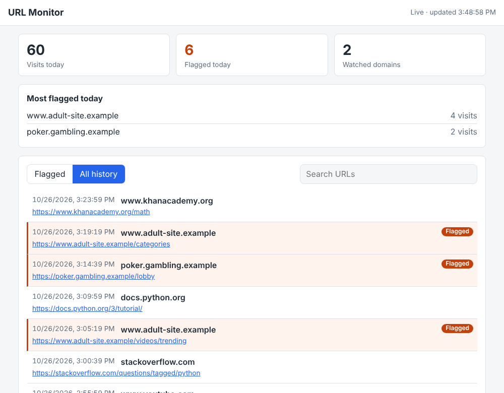

# URL Monitor

[](https://github.com/snb-dev/url-monitoring-system-Proxy-based/actions/workflows/ci.yml)
[](LICENSE)

URL Monitor records the websites visited on a Windows computer and flags (or
blocks) visits to domains on a watch list, such as adult sites. It is intended
for **parents supervising their own children's computers** and for **people who
want to hold themselves accountable**.

It works as a local proxy built on [mitmproxy](https://mitmproxy.org/). Browser
traffic goes through it, and a password-protected dashboard shows the history,
today's flagged visits, and alerts as they happen. Everything stays on the
computer: nothing is sent anywhere.



## Use it responsibly

URL Monitor can read the addresses of every page visited, including HTTPS pages.
Only install it on a computer you own or administer, and only monitor people who
know about it and have agreed to it, or children in your care. Secretly recording
another adult's internet use is illegal in many countries. You are responsible
for complying with the laws where you live.

## Install

1. Download `URLMonitor-Setup-<version>.exe` from the
   [latest release](https://github.com/snb-dev/url-monitoring-system-Proxy-based/releases/latest).
2. Run it. Administrator rights are **not** needed. If Windows SmartScreen says
   it "protected your PC", click **More info → Run anyway**.
3. Choose whether URL Monitor should start when you sign in (on by default).

Requires Windows 10 or 11 (64-bit). To run from source or on macOS and Linux, see
[Other ways to run it](#other-ways-to-run-it).

## First start

On the first start, URL Monitor:

1. Creates a certificate authority that exists only on this computer, and asks
   Windows to trust it. Windows shows a security warning: click **Yes**. Without
   it, URL Monitor can't read HTTPS pages, so it exits without changing anything.
2. Generates a dashboard password and shows it. It is also stored in the
   settings file (see [Settings](#settings)). The dashboard user name is `admin`.
3. Points the Windows proxy settings at itself and opens the dashboard at
   `http://127.0.0.1:5000`.

URL Monitor runs in a console window, so it is always visible that monitoring is
on. Close the window or press **Ctrl+C** to stop it; your original proxy
settings are put back when it stops.

The Start menu has shortcuts to start it, open the dashboard, check its status,
and restore your proxy settings.

## Commands

Run `URLMonitor.exe <command>` from the install folder (or `urlmonitor <command>`
/ `python -m urlmonitor <command>` when running from source).

| Command | What it does |
| --- | --- |
| `start` | Start monitoring (the default). `start --manual` leaves Windows settings alone, for pointing a browser at the proxy yourself. |
| `status` | Show whether it is running, the proxy and certificate state, and how much history is stored. |
| `restore` | Put your proxy settings back if web pages stop loading. |
| `autostart on` / `off` | Start URL Monitor when you sign in to Windows, or stop doing so. |
| `update-blocklist [--url URL]` | Download a public domain list to flag. |
| `install-cert` | Trust URL Monitor's certificate. |
| `uninstall-cert` | Remove the certificate and delete its private key. |

## What gets recorded

By default URL Monitor records **the pages that are opened**: one entry per page,
not every image, script and tracker the page loads. Frames embedded from watched
sites (for example, an embedded video) are recorded too. Set `log_mode = "all"`
to record every request a browser makes.

Only browser traffic is recorded. History older than 90 days is deleted
automatically; change this with `retention_days`.

## The watch list

Add domains to `blocklist.txt` in the data folder, one per line. A domain also
matches its subdomains, so `example.com` flags `www.example.com` and
`m.example.com`. Hosts-file lines (`0.0.0.0 example.com`) and pasted URLs work
too. Changes are picked up within a few seconds; no restart needed.

To flag adult sites without maintaining a list yourself, run:

```bat
URLMonitor.exe update-blocklist
```

This downloads the [StevenBlack/hosts](https://github.com/StevenBlack/hosts)
"porn-only" list (over 60,000 domains) to `blocklist_downloaded.txt`. That list
is maintained by its own authors under its own license. Use `--url` to download
any other hosts file or plain domain list. Run it again to update.

To **block** watched sites instead of only flagging them, set
`block_watched_sites = true`. Blocked pages show a "This site is blocked" page,
and the attempt is recorded.

## Settings

Settings are in `config.toml` in the data folder. Restart URL Monitor after
changing it.

```toml
[dashboard]
password = "generated on first run"
port = 5000

[proxy]
port = 8081

[monitoring]
log_mode = "pages"          # or "all"
retention_days = 90         # 0 keeps everything
block_watched_sites = false
```

## Where data is stored

| System | Data folder |
| --- | --- |
| Windows | `%LOCALAPPDATA%\URLMonitor` |
| macOS | `~/Library/Application Support/URLMonitor` |
| Linux | `~/.local/share/urlmonitor` |

Set the `URLMON_DATA_DIR` environment variable to use another folder. Earlier
versions kept their data in a `data` folder next to the program; it is moved to
the new location, and its JSON logs are imported, on the first start.

| File | Contents |
| --- | --- |
| `history.db` | Browsing history (SQLite) |
| `config.toml` | Settings and the dashboard password |
| `blocklist.txt` | Your watch list |
| `blocklist_downloaded.txt` | Downloaded public list |
| `certs/` | The certificate authority, including its **private key** |
| `proxy_state.json` | Your proxy settings, saved while monitoring is on |

Keep `certs/` private: anyone with that key could intercept HTTPS traffic on any
computer that trusts the certificate. `uninstall-cert` removes the certificate
from Windows and deletes the key.

## If web pages stop loading

URL Monitor restores your proxy settings when you press Ctrl+C or close its
window, and it also arranges a restore at your next sign-in in case the computer
crashes. If pages still don't load, use **Start menu → URL Monitor → Restore
proxy settings** (or `restore_proxy.bat` when running from source).

To do it by hand: **Settings → Network & internet → Proxy → Manual proxy setup
→ Use a proxy server: Off**.

## Firefox

Firefox has its own certificate list. If it shows certificate errors, open
`about:config` and set `security.enterprise_roots.enabled` to `true`.

## Uninstalling

Uninstall **URL Monitor** from **Settings → Apps**. The uninstaller stops it,
restores your proxy settings, turns off starting at sign-in, and removes the
certificate (Windows asks you to confirm). Your history and settings stay in the
data folder; delete that folder to remove them too.

## Other ways to run it

### From source on Windows

Install [Python 3.11 or newer](https://www.python.org/downloads/) (tick **"Add
python.exe to PATH"**), download or clone this repository, and double-click
**`start.bat`**. On the first run it installs the Python packages it needs.
`start.bat <command>` runs any of the [commands](#commands), and `start.bat
autostart on` makes it start at sign-in.

### With pip

```bash
pip install git+https://github.com/snb-dev/url-monitoring-system-Proxy-based.git
urlmonitor start
```

### macOS and Linux

Run `urlmonitor start` (or `python3 -m urlmonitor start` from a checkout). Proxy
and certificate setup are automatic only on Windows, so also:

1. Trust `certs/mitmproxy-ca-cert.pem` from the data folder in your browser or
   operating system.
2. Set the browser's HTTP and HTTPS proxy to `127.0.0.1:8081`.

## Security

- The proxy and dashboard listen on `127.0.0.1` only, so other devices on the
  network can't reach them.
- The dashboard requires a password and sends a strict Content Security Policy.
- Each installation creates its own certificate. No certificate or key ships
  with URL Monitor.

To report a vulnerability, see [SECURITY.md](SECURITY.md).

## Contributing

Contributions are welcome. See [CONTRIBUTING.md](CONTRIBUTING.md) for the
development setup, checks, and how releases are made. Changes are listed in
[CHANGELOG.md](CHANGELOG.md).

| Module | Purpose |
| --- | --- |
| `cli.py` | Commands and start-up |
| `addon.py` | mitmproxy addon: decides what to record, flag and block |
| `storage.py` | SQLite history |
| `blocklist.py` | Watch list parsing, matching and downloads |
| `dashboard.py` | Flask API and login; the UI is in `web/` |
| `winproxy.py`, `_launcher.py` | Windows proxy settings, crash recovery and start at sign-in |
| `certs.py` | Certificate creation and trust |
| `config.py` | Data folder and `config.toml` |

## License

[MIT](LICENSE)
